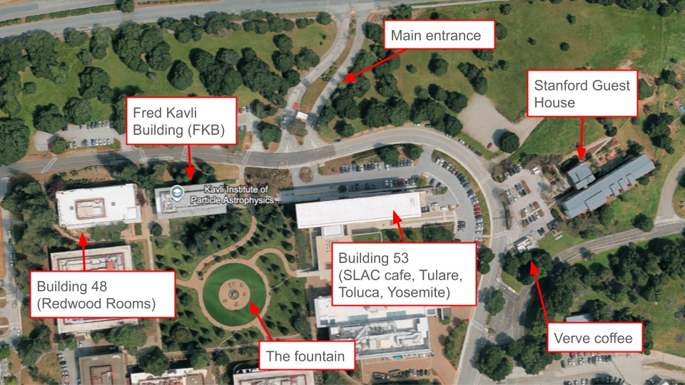

The Sprint Week is hosted at SLAC National Accelerator Laboratory and at LPNHE (Sorbonne Université) in Paris; both sites are equal partners.
The SLAC site is supported by the Kavli Institute for Particle Astrophysics and Cosmology (KIPAC), whose workshop program also provides the coffee breaks and lunches.

## Getting here

**Address:** SLAC National Accelerator Laboratory, 2575 Sand Hill Road, Menlo Park, CA 94025, USA.
KIPAC also has a location on Stanford's main campus, but this Sprint Week is at SLAC, so use the SLAC address when planning your journey.

### From San Francisco airport (SFO)

- **By car, taxi or rideshare:** take US-101 South, CA-92 West and I-280 South, exit at Sand Hill Road East and continue to the main gate.
- **By public transport:** take BART from SFO to Millbrae, then a southbound Caltrain to Palo Alto, then a taxi, a rideshare or the Marguerite Line S shuttle (below).

### From San José airport (SJC)

- **By car, taxi or rideshare:** take I-880 South and I-280 North, and exit at Sand Hill Road East.
- **By public transport:** take VTA Route 60 toward Winchester to the Santa Clara Transit Center, then a northbound Caltrain to Palo Alto, and continue as above.

### Shuttles and parking

- Stanford's free **Marguerite Line S** connects the Palo Alto Transit Center with SLAC during the weekday morning and afternoon commute only (no all-day or weekend service).
- The **Marguerite SLAC line** connects SLAC with Stanford's main campus.
- Check the timetables before relying on either shuttle.
- Visitor parking at SLAC is free.

## Site access

Site access is granted to meeting registrants, and the normal SLAC site access procedures do not apply.
Enter through the **main gate on Sand Hill Road**, with a REAL ID-compliant form of identification or an accepted alternative such as a valid passport.
If you registered to attend in person at SLAC, you should have received an email with instructions on October 19.
Take your visitor badge and ID with you whenever you leave SLAC, so you can get back in.
If anything goes wrong, post in **#desc-hack-sprint** on Slack.

## Buildings and rooms

All SLAC sprint sessions are in three buildings near the main gate, a short walk from one another.
Building numbers and grid squares refer to the official SLAC visitor map.

| Building | What is there | Map grid |
| --- | --- | --- |
| 51 | Fred Kavli Building (FKB): two conference rooms, the Kavli auditorium | 31-B |
| 53 | Science and User Support Building (SUSB): Toluca, Tulare and Yosemite rooms, security office, SLACafé | 32-C |
| 48 | Research Office Building (ROB): the Redwood rooms | 30-B |
| 83 | Main gate on Sand Hill Road | 31-B |
| 49 | Stanford Guest House | 33-B |

| Room (as named on this calendar) | Building | Room number | Capacity |
| --- | --- | --- | --- |
| FKB 2nd floor conference room | 51 (FKB) | 222 | 20 |
| FKB 3rd floor conference room | 51 (FKB) | 305 | 48 |
| B53 Toluca | 53 (SUSB) | 4002 | 28 |
| B53 Tulare | 53 (SUSB) | 4006 | 28 |
| B53 Yosemite | 53 (SUSB) | 4050 | 12 |
| Redwoods A-B | 48 (ROB) | 112A | 45 (up to 70) |
| Redwoods C-D | 48 (ROB) | 112B | 45 (up to 70) |

Each Redwood room is listed at 60 people: the default layout seats 45, and up to 70 fit with extra tables and chairs.
Room availability varies by day: see **Rooms** below, or the **Rooms** tab for what is booked where.
For small-group discussions you can also use the second-floor lounge in FKB and the patio outside ROB.

The building entrances are open during normal working hours.
Each building has men's and women's restrooms on the ground floor and gender-neutral restrooms on the second and third floors.

## Food and coffee

Coffee and tea are served during the scheduled breaks, and a hot lunch is provided every day (times in the daily program below):

- **Monday and Tuesday:** outside the Kavli auditorium, on the first floor of FKB (building 51).
- **Wednesday to Friday:** outside the Redwood rooms, in building 48.

You can also buy food and drinks on site or nearby:

- **SLACafé:** on the second floor of building 53, a short walk from the meeting rooms; a convenient weekday lunch option (check the SLAC dining page for current hours).
- **Verve Coffee Roasters:** a kiosk beside the Stanford Guest House (building 49), with coffee and seasonal breakfast and lunch items, open 7 am to 2 pm.
- **Sand Hill Kitchen:** 2400 Sand Hill Road, across the road from SLAC and about a 10-minute walk from the main entrance; brunch and lunch, Monday to Friday, 8 am to 3 pm.
- **Sharon Heights Shopping Center:** a 15 to 20-minute walk down Sand Hill Road toward Sharon Park Drive, with Eric's Gourmet (sandwiches and deli), Woodside Bakery and Cafe (coffee and pastries), Starbucks and Safeway.

For dinner, downtown Menlo Park and Palo Alto are a short drive or rideshare away.

## Staying connected

- **Slack** (Discovery Alliance workspace): **#desc-hack-sprint** is the main channel for the meeting, **#desc-sprint-hotline** is for Zoom and technical support, and **#desc-collab-hangs** is for organizing social activities.
- **Wi-Fi:** _details to be added._

## Accommodation

- The **Stanford Guest House** (building 49) is on the SLAC campus, within walking distance of the meeting rooms.
  The DESC room block expired on October 2, but you can still try to book a room.
- Other hotels are in Menlo Park and Palo Alto.
  When choosing one, consider how you will reach SLAC each day: a hotel close to Stanford's main campus may still need a shuttle or car journey.
- To share a house or hotel room, see the SLAC 2026 Accommodation Sharing page on Confluence.
- If you need a letter of invitation, for example for a visa, contact the chair(s) of the LOC.

## Code of conduct and Meeting Contact Persons

The DESC Professional Conduct Policy applies, in particular its meeting code of conduct (page 5) and meeting contact person policy (page 6).
The Meeting Contact Persons (MCPs) help participants who experience conflicts or disputes during the meeting:

- **At SLAC:** Theo Schutt and Aaron Roodman.
- **In Paris:** Juan Mena-Fernández and Céline Combet (IAP).

Reach any of them on Slack to chat, or to set up an in-person or Zoom meeting.
Both in-person and remote attendees may contact any MCP.

## Social and things to do

There is a **welcome reception** with pizza and drinks on Monday evening; see the daily program below for the time and place.
To plan outings with others, post in **#desc-collab-hangs**.

### Restaurants

- Rossotti's Alpine Inn: a popular beer garden with a pizza oven, sandwiches and a bar.
- The Sand Hill Kitchen: across the street from SLAC, within walking distance.
- Zareen's Palo Alto.
- Wildseed (vegan).
- Tootsie's at the Cantor Arts Center, on Stanford's campus.

### Coffee within walking distance

- Verve: next to the Stanford Guest House, on the SLAC campus (7 am to 2 pm).
- Bici: about a 15-minute walk.

### Coffee further out

Blue Bottle Coffee (Palo Alto, Stanford Shopping Center and elsewhere), Philz Coffee (Palo Alto, Menlo Park and elsewhere), Backyard Brew (Palo Alto), and Wanpo Tea Shop (Stanford Shopping Center).

### Hiking

- Stanford Dish: close to SLAC, passing an old radio telescope, with views over Stanford and the Bay.
- Windy Hill Preserve.
- Purisima Creek Redwoods Open Space Preserve.
- Castle Rock State Park, which also has great outdoor climbing.

### Museums

- Computer History Museum: excellent, $18 per adult.
- Cantor Arts Center: free, with an extensive collection of Rodin sculptures and rotating exhibitions.
- Anderson Collection at Stanford University: free, modern and contemporary art.

### On or near Stanford's campus

- Stanford Theatre: films from the Golden Age of Hollywood, with cheap tickets; it shows _The Wizard of Oz_ and _Mary Poppins_ from October 29 to November 1.
- The Cactus Garden (also called the Arizona Garden).
- The Papua New Guinea Sculpture Garden.
